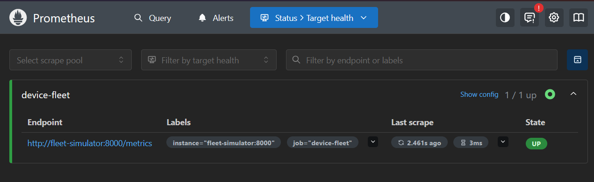
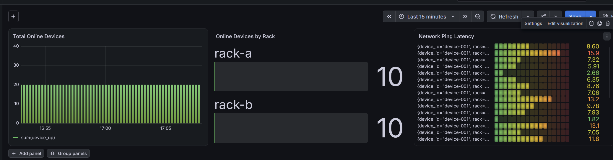
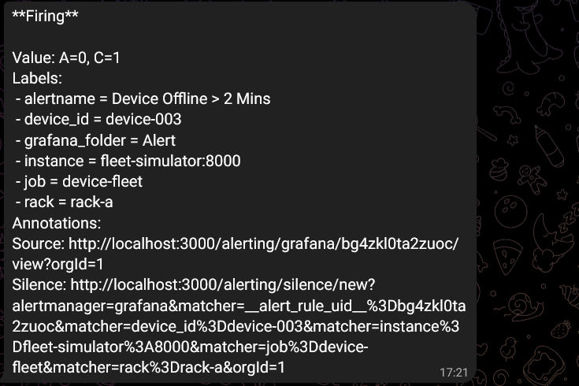

# Fleet Monitoring & Alerting Pipeline

A containerized SRE observability and alerting stack built with **Python, Docker, Prometheus, and Grafana**. It simulates a 20-device hardware fleet across two racks (`rack-a` and `rack-b`), scrapes real-time health telemetry, and sends automated Telegram alerts when any device stays unreachable for over 2 minutes.

## 🏗️ Architecture

```text
[Python Fleet Exporter :8000] ---> [Prometheus :9090] ---> [Grafana :3000] ---> [Telegram Bot Alert]
 (20 devices across 2 racks)       (Scrapes every 15s)     (Dashboards + 2m rule)




